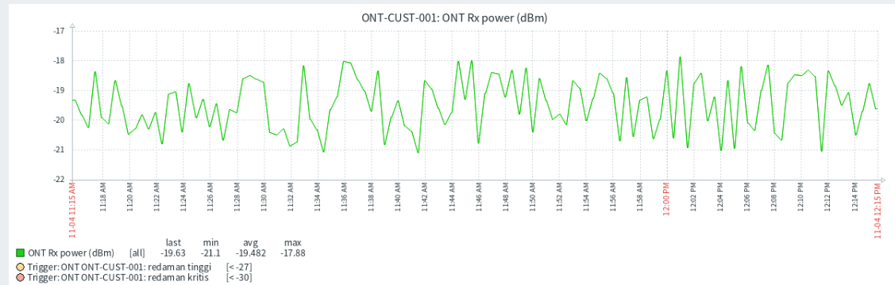
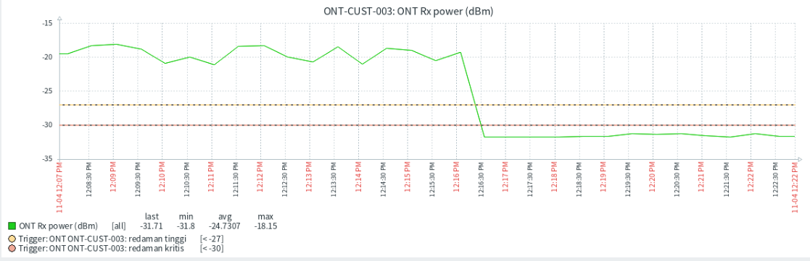
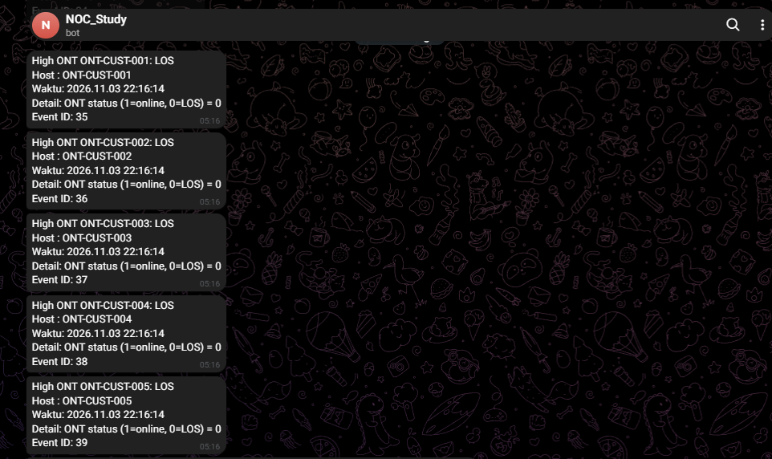
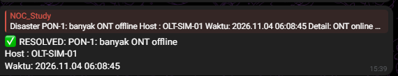
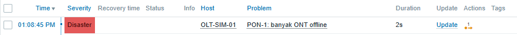
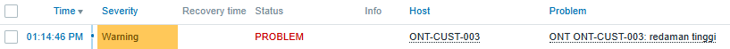
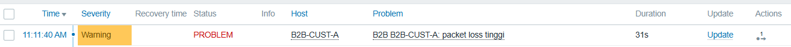
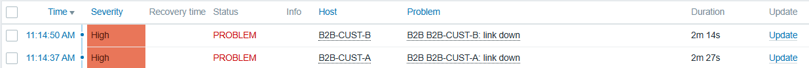
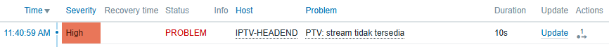

# NOC Multi-Service Monitoring Stack

Lab simulasi Network Operations Center (NOC) end-to-end untuk memantau tiga layanan utama ISP: **FTTH**, **B2B**, dan **IPTV**. Dibangun dengan Zabbix 7.0, Docker, dan notifikasi otomatis melalui Telegram.

---

## Ringkasan

Project ini mereplikasi alur kerja monitoring di lingkungan ISP, mulai dari pengumpulan data perangkat, deteksi gangguan, hingga eskalasi insiden ke tim NOC. Gangguan jaringan disimulasikan dengan metode *fault injection* untuk memvalidasi bahwa sistem monitoring dan alerting bekerja sesuai skenario operasional nyata.

## Tujuan

- **Validasi troubleshooting:** mensimulasikan gangguan nyata seperti fiber putus, packet loss, dan link B2B down melalui fault injection.
- **Incident management:** mendeteksi gangguan secara real-time dan mengirim notifikasi berjenjang (Warning, High, Disaster) ke tim NOC.
- **Mitigasi alert fatigue:** menerapkan logika severity pada Zabbix agar alarm turunan tidak membanjiri tim saat gangguan utama terjadi.
- **Otomatisasi:** memanfaatkan skrip Python dan Bash untuk mensimulasikan data perangkat OLT/ONT serta memantau kualitas stream IPTV.

## Arsitektur dan Teknologi

| Komponen | Teknologi |
| :--- | :--- |
| Core monitoring | Zabbix 7.0, PostgreSQL |
| Otomatisasi dan simulator | Python (`ont_simulator.py`), Bash (`iptv_check.sh`) |
| Alerting | Telegram Bot (webhook) |
| Fault injection | Python state files, `tc` (netem), `iptables` |
| Infrastruktur | Docker, Docker Compose, Ubuntu Server 24.04 |

## Skenario Pengujian

| Kode | Skenario | Layanan | Severity |
| :---: | :--- | :--- | :---: |
| F1 | Fiber cut (PON LOS) | FTTH | Disaster |
| F2 | Degradasi sinyal optik (redaman tinggi) | FTTH | Warning / High |
| F3 | Packet loss | B2B | Warning |
| F4 | Link down | B2B | High |
| F5 | Stream down | IPTV | High |

---

## Hasil Pengujian

### 1. Visualisasi Data: Kondisi Normal vs Gangguan

Sistem memantau daya optik (Rx Power) pada pelanggan FTTH. Ketika sinyal turun di bawah -30 dBm, alarm otomatis terpicu.

| Kondisi Normal (-20 dBm) | Simulasi Gangguan (-31.5 dBm) |
| :---: | :---: |
|  |  |
| Sinyal stabil, tidak ada alarm. | Sinyal turun drastis, alarm Warning/High terpicu. |

### 2. Notifikasi Telegram

Saat gangguan terdeteksi, bot mengirim notifikasi ke grup NOC. Setelah gangguan pulih, bot mengirim pesan `RESOLVED`.

<p align="center">
  
  &nbsp;&nbsp;&nbsp;
  
</p>

### 3. Dashboard Zabbix per Skenario

<details>
<summary>Tampilkan screenshot skenario F1 sampai F5</summary>

<br>

**F1: Fiber Cut (PON LOS)** — memicu alarm Disaster.



**F2: FTTH Degradation** — memicu alarm Warning/High akibat redaman.



**F3: B2B Packet Loss** — memicu alarm Warning.



**F4: B2B Link Down** — memicu alarm High.



**F5: IPTV Stream Down** — memicu alarm High.



</details>

---

## Menjalankan Project

### Prasyarat

- Ubuntu Server 24.04 (atau distro Linux lain yang kompatibel)
- Docker dan Docker Compose
- Telegram Bot Token dan Chat ID untuk integrasi alerting

### Instalasi

```bash
git clone https://github.com/ridhoksatrio/monitoring-stack.git
cd monitoring-stack
cp .env.example .env      # lalu ubah POSTGRES_PASSWORD
docker compose up -d
```

Zabbix Web UI tersedia di `http://localhost:8081`. Kredensial bawaan Zabbix adalah `Admin` / `zabbix`; ganti password setelah login pertama.

Setelah seluruh container berjalan, import template dari folder `zabbix/templates/`, daftarkan host, lalu konfigurasikan media type Telegram dengan token bot dan chat ID Anda sendiri.

## Batasan

- Data OLT dan ONT dihasilkan oleh simulator Python, bukan perangkat fisik.
- Lingkungan ini ditujukan untuk lab: komunikasi antar komponen tidak dienkripsi dan belum ada high availability maupun backup database.
- Image Zabbix memakai tag `ubuntu-7.0-latest`; untuk penggunaan produksi, versi sebaiknya dikunci.
